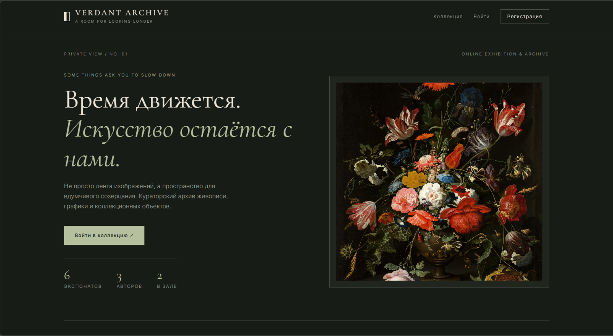
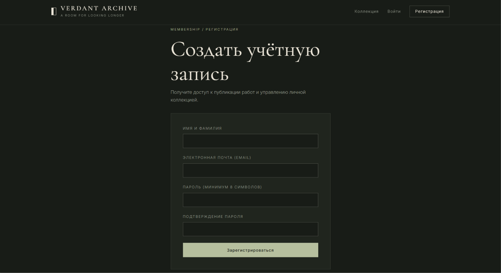

# VERDANT ARCHIVE
### Кураторская онлайн-галерея и каталог произведений искусства

## 1. Описание лабораторной работы

**Название проекта:** Verdant Archive — онлайн-галерея и каталог произведений искусства.

**Цель работы:** разработать динамическое веб-приложение с использованием PHP и MySQL, реализовать регистрацию и авторизацию пользователей, работу с базой данных, обработку пользовательских форм, поиск и фильтрацию информации, а также разграничение прав доступа.

**Используемые технологии:**
- PHP 8+
- MySQL
- HTML5
- CSS3
- PDO (PHP Data Objects)
- XAMPP
- phpMyAdmin

Проект представляет собой онлайн-архив произведений искусства, в котором посетители могут просматривать коллекцию, изучать информацию о картинах, искать произведения по различным параметрам и регистрироваться для получения доступа к дополнительным функциям.

Приложение предусматривает две основные роли пользователей: обычный пользователь и администратор (куратор).

---

## 2. Инструкция по запуску проекта

Для локального запуска используется программный пакет XAMPP, который обеспечивает работу Apache и MySQL.

### 2.1. Подготовка проекта

1. Установить и открыть XAMPP Control Panel.
2. Скопировать папку `VerdantArchive` в директорию:

   `C:\xampp\htdocs\`

3. Запустить модули Apache и MySQL.

### 2.2. Создание базы данных

1. Открыть браузер.
2. Перейти по адресу:

   `http://localhost/phpmyadmin`

3. Перейти во вкладку SQL.
4. Открыть файл `database.sql`, находящийся в корневой папке проекта.
5. Скопировать его содержимое и выполнить SQL-запрос.

В результате будет создана база данных `verdant_archive` со следующими таблицами:
- `users`
- `artworks`
- `password_resets`

Также SQL-файл содержит три первоначальных примера произведений искусства.

### 2.3. Настройка подключения

Файл `config/Database.php` содержит параметры подключения к MySQL:

- Host: `localhost`
- Database: `verdant_archive`
- Username: `root`
- Password: пустой

При использовании стандартной конфигурации XAMPP дополнительные изменения не требуются.

### 2.4. Запуск приложения

Открыть браузер и перейти по адресу:

`http://localhost/VerdantArchive/`

Для получения административного доступа необходимо зарегистрировать первого пользователя. При первой регистрации ему автоматически назначается роль `admin`. Все последующие зарегистрированные пользователи получают роль `user`.

---

## 3. Содержание проекта

### 3.1. Структура файлов

```text
VerdantArchive/
│
├── admin/
│   ├── index.php
│   ├── edit_artwork.php
│   └── create_admin.php
│
├── assets/
│   └── style.css
│
├── config/
│   └── Database.php
│
├── core/
│   ├── Auth.php
│   ├── Security.php
│   └── Validator.php
│
├── includes/
│   ├── header.php
│   └── footer.php
│
├── add_artwork.php
├── artwork.php
├── dashboard.php
├── forgot_password.php
├── index.php
├── login.php
├── logout.php
├── register.php
├── database.sql
└── README.md
```

### 3.2. Назначение основных файлов

| Файл / папка | Назначение |
|---|---|
| `index.php` | Главная страница, отображение коллекции, поиск и фильтрация |
| `artwork.php` | Подробная информация об отдельном произведении |
| `register.php` | Регистрация пользователей |
| `login.php` | Авторизация пользователей |
| `logout.php` | Завершение пользовательской сессии |
| `dashboard.php` | Личный кабинет пользователя |
| `add_artwork.php` | Добавление произведений в каталог |
| `forgot_password.php` | Восстановление пароля |
| `admin/index.php` | Административная панель |
| `admin/edit_artwork.php` | Редактирование произведений |
| `admin/create_admin.php` | Создание новых администраторов |
| `config/Database.php` | Подключение к базе данных |
| `core/Auth.php` | Управление авторизацией и правами доступа |
| `core/Security.php` | Защитные механизмы приложения |
| `core/Validator.php` | Проверка введённых данных |
| `includes/header.php` | Общая верхняя часть страниц |
| `includes/footer.php` | Общая нижняя часть страниц |
| `assets/style.css` | Стилизация интерфейса |
| `database.sql` | Создание и заполнение базы данных |

---

## 4. Функциональные возможности приложения

### 4.1. Главная страница

На главной странице отображается коллекция произведений искусства. Для каждого произведения предусмотрена карточка с изображением, названием и информацией об авторе.

Дополнительно реализованы:
- Динамический подсчёт общего количества произведений.
- Подсчёт уникальных авторов.
- Подсчёт произведений, находящихся в постоянной экспозиции.
- Поиск по названию, автору и описанию.
- Фильтрация по художественной технике.
- Фильтрация по статусу произведения.

### 4.2. Регистрация и авторизация

Пользователь может создать учётную запись, указав:
- Имя и фамилию.
- Электронную почту.
- Пароль.
- Подтверждение пароля.

Предусмотрена проверка корректности email, длины имени, совпадения паролей и уникальности электронной почты.

Пароли сохраняются в базе данных в виде хешей.

### 4.3. Личный кабинет

После авторизации пользователь получает доступ к личному кабинету.

В зависимости от роли пользователя доступны соответствующие действия. Пользователь может работать со своей учётной записью и добавлять произведения в каталог.

### 4.4. Добавление произведений искусства

Авторизованный пользователь может добавить новое произведение, указав:
- Название.
- Имя художника.
- Технику исполнения.
- Габариты.
- Год создания.
- Статус.
- Описание.
- URL изображения.

Перед сохранением информация проходит серверную проверку.

### 4.5. Административная панель

Администратор имеет дополнительные возможности:
- Просмотр всех произведений.
- Добавление новых произведений.
- Редактирование существующих записей.
- Удаление произведений.
- Просмотр зарегистрированных пользователей.
- Изменение ролей пользователей.
- Удаление учётных записей.
- Создание новых администраторов.

### 4.6. Восстановление пароля

В приложении предусмотрен механизм восстановления пароля. Пользователь указывает электронную почту, после чего генерируется уникальный токен сброса пароля.

Срок действия токена составляет один час. В локальном режиме ссылка отображается непосредственно на странице, без отправки электронного письма.

---

## 5. Сценарии взаимодействия пользователей с приложением

### Сценарий 1. Просмотр коллекции

1. Посетитель открывает главную страницу.
2. Приложение получает список произведений из базы данных.
3. Пользователь просматривает карточки произведений.
4. При необходимости вводит название или имя автора в поисковую строку.
5. Выбирает технику исполнения или статус.
6. Получает отфильтрованный список произведений.
7. Нажимает на карточку для просмотра подробной информации.

### Сценарий 2. Регистрация пользователя

1. Посетитель переходит на страницу регистрации.
2. Заполняет необходимые поля.
3. Приложение проверяет корректность введённых данных.
4. Проверяется, существует ли пользователь с таким email.
5. Пароль преобразуется в хеш.
6. Данные сохраняются в таблице `users`.
7. Пользователь перенаправляется на страницу авторизации.

### Сценарий 3. Авторизация

1. Пользователь открывает страницу входа.
2. Вводит email и пароль.
3. Приложение ищет пользователя в базе данных.
4. Проверяется соответствие введённого пароля сохранённому хешу.
5. При успешной проверке создаётся пользовательская сессия.
6. Пользователь получает доступ к соответствующим разделам приложения.

### Сценарий 4. Добавление произведения

1. Авторизованный пользователь открывает форму добавления.
2. Заполняет информацию о произведении.
3. Приложение проверяет введённые данные.
4. Если ошибок нет, информация сохраняется в таблице `artworks`.
5. Произведение становится доступным в каталоге.

### Сценарий 5. Управление каталогом администратором

1. Администратор входит в систему.
2. Открывает административную панель.
3. Просматривает список произведений и зарегистрированных пользователей.
4. При необходимости редактирует или удаляет произведение.
5. Может изменить роль другого пользователя или удалить его учётную запись.
6. Все изменения сохраняются в базе данных.

---

## 6. Структура базы данных

Название базы данных: `verdant_archive`.

База данных состоит из трёх таблиц.

### 6.1. Таблица `users`

Хранит информацию о зарегистрированных пользователях.

| Поле | Тип данных | Описание |
|---|---|---|
| `id` | INT UNSIGNED | Первичный ключ, идентификатор пользователя |
| `full_name` | VARCHAR(100) | Имя и фамилия |
| `email` | VARCHAR(190) | Электронная почта, уникальное значение |
| `password_hash` | VARCHAR(255) | Хеш пароля |
| `role` | ENUM | Роль пользователя: user или admin |
| `created_at` | TIMESTAMP | Дата регистрации |

### 6.2. Таблица `artworks`

Хранит информацию о произведениях искусства.

| Поле | Тип данных | Описание |
|---|---|---|
| `id` | INT UNSIGNED | Первичный ключ |
| `title` | VARCHAR(160) | Название произведения |
| `artist` | VARCHAR(120) | Имя автора |
| `medium` | VARCHAR(80) | Техника исполнения |
| `dimensions` | VARCHAR(60) | Габариты произведения |
| `creation_year` | SMALLINT UNSIGNED | Год создания |
| `status` | ENUM | Статус произведения |
| `description` | TEXT | Описание произведения |
| `image_url` | VARCHAR(500) | Ссылка на изображение |
| `created_by` | INT UNSIGNED | Идентификатор пользователя, добавившего произведение |
| `created_at` | TIMESTAMP | Дата добавления |

Допустимые значения поля `status`:
- `exhibition` — произведение находится в экспозиции.
- `private` — произведение находится в частной коллекции.
- `available` — произведение доступно для приобретения.

### 6.3. Таблица `password_resets`

Используется для хранения данных восстановления пароля.

| Поле | Тип данных | Описание |
|---|---|---|
| `id` | INT UNSIGNED | Первичный ключ |
| `email` | VARCHAR(190) | Email пользователя |
| `token` | VARCHAR(64) | Уникальный токен восстановления |
| `expires_at` | DATETIME | Срок действия токена |
| `created_at` | TIMESTAMP | Дата создания записи |

### 6.4. Связи между таблицами

В базе данных реализована следующая связь:

- `users.id` → `artworks.created_by`.

Один пользователь может добавить несколько произведений искусства. Каждое произведение может быть связано с одним пользователем.

Связь реализована через внешний ключ `fk_artworks_user`.

При удалении пользователя его произведения не удаляются. Значение `created_by` устанавливается в `NULL` благодаря правилу `ON DELETE SET NULL`.

---

## 7. Примеры использования проекта и фрагменты кода

### 7.1. Подключение к базе данных

**Файл:** `config/Database.php`

```php
$dsn = sprintf(
    'mysql:host=%s;dbname=%s;charset=utf8mb4',
    self::$host,
    self::$dbName
);

self::$instance = new PDO(
    $dsn,
    self::$username,
    self::$password,
    [
        PDO::ATTR_ERRMODE => PDO::ERRMODE_EXCEPTION,
        PDO::ATTR_DEFAULT_FETCH_MODE => PDO::FETCH_ASSOC,
        PDO::ATTR_EMULATE_PREPARES => false,
    ]
);
```

**Описание:** для взаимодействия приложения с MySQL используется PDO. Подключение создаётся с указанием сервера, названия базы данных и кодировки UTF-8. Использование Singleton позволяет повторно использовать один экземпляр подключения в рамках выполнения PHP-скрипта.

### 7.2. Получение и фильтрация произведений

**Файл:** `index.php`

```php
$sql = "SELECT a.*, u.full_name AS curator_name
        FROM artworks a
        LEFT JOIN users u ON u.id = a.created_by
        WHERE 1=1";

if ($query !== '') {
    $sql .= " AND (
        a.title LIKE :q1
        OR a.artist LIKE :q2
        OR a.description LIKE :q3
    )";

    $like = '%' . $query . '%';

    $params['q1'] = $like;
    $params['q2'] = $like;
    $params['q3'] = $like;
}

$stmt = $pdo->prepare($sql);
$stmt->execute($params);
$artworks = $stmt->fetchAll();
```

**Описание:** данный код получает произведения из таблицы `artworks` и информацию об авторах записей из таблицы `users`. Для поиска используется оператор `LIKE`, позволяющий находить совпадения по части введённого текста. Подготовленный запрос PDO обеспечивает безопасную передачу параметров.

### 7.3. Регистрация пользователя

**Файл:** `register.php`

```php
$insert = $pdo->prepare(
    'INSERT INTO users
    (full_name, email, password_hash, role)
    VALUES (?, ?, ?, ?)'
);

$insert->execute([
    $fullName,
    $email,
    password_hash($password, PASSWORD_DEFAULT),
    $role,
]);
```

**Описание:** после проверки данных приложение добавляет нового пользователя в таблицу `users`. Пароль перед сохранением преобразуется в хеш с помощью `password_hash()`. Роль пользователя определяется автоматически: первый зарегистрированный пользователь получает роль администратора, остальные — обычного пользователя.

### 7.4. Проверка пароля при авторизации

**Файл:** `login.php`

```php
$stmt = $pdo->prepare(
    'SELECT id, full_name, email, password_hash, role
     FROM users WHERE email = ?'
);

$stmt->execute([$email]);
$user = $stmt->fetch();

if ($user && password_verify($password, $user['password_hash'])) {
    Auth::login($user);
    header('Location: dashboard.php');
    exit;
}
```

**Описание:** приложение ищет пользователя по электронной почте и проверяет пароль с помощью `password_verify()`. При успешной проверке вызывается метод `Auth::login()`, который сохраняет данные пользователя в сессии и обновляет идентификатор сессии.

### 7.5. Добавление произведения искусства

**Файл:** `add_artwork.php`

```php
$errors = Validator::validateArtwork($data);

if (!$errors) {
    $stmt = $pdo->prepare("
        INSERT INTO artworks
        (title, artist, medium, dimensions, creation_year,
         status, description, image_url, created_by)
        VALUES (?, ?, ?, ?, ?, ?, ?, ?, ?)
    ");

    $stmt->execute([
        $data['title'],
        $data['artist'],
        $data['medium'],
        $data['dimensions'],
        (int)$data['creation_year'],
        $data['status'],
        $data['description'],
        $data['image_url'] !== '' ? $data['image_url'] : null,
        Auth::user()['id'],
    ]);
}
```

**Описание:** перед добавлением произведения вызывается метод `validateArtwork()` класса `Validator`. Если данные соответствуют установленным требованиям, выполняется SQL-запрос `INSERT INTO`, который сохраняет информацию в таблице `artworks`. Также записывается идентификатор пользователя, добавившего произведение.

### 7.6. Проверка прав администратора

**Файл:** `core/Auth.php`

```php
public static function isAdmin(): bool
{
    return self::check()
        && ($_SESSION['user']['role'] ?? '') === 'admin';
}
```

**Описание:** метод проверяет наличие активной пользовательской сессии и роль текущего пользователя. Он используется для разграничения доступа к административным функциям приложения.

### 7.7. Защита от XSS-атак

**Файл:** `core/Security.php`

```php
public static function escape(?string $value): string
{
    return htmlspecialchars(
        (string)$value,
        ENT_QUOTES | ENT_SUBSTITUTE,
        'UTF-8'
    );
}
```

**Описание:** метод преобразует специальные символы в HTML-сущности перед отображением пользовательских данных. Это предотвращает выполнение внедрённого HTML-кода и JavaScript при выводе данных на страницу.

### 7.8. Защита форм с помощью CSRF-токена

**Файл:** `core/Security.php`

```php
public static function getCsrfToken(): string
{
    self::initSession();

    if (empty($_SESSION['csrf_token'])) {
        $_SESSION['csrf_token'] = bin2hex(random_bytes(32));
    }

    return $_SESSION['csrf_token'];
}
```

**Описание:** метод генерирует уникальный случайный токен для пользовательской сессии. Токен добавляется в формы и проверяется при отправке данных. Для сравнения используется функция `hash_equals()`.

### 7.9. Проверка введённых данных

**Файл:** `core/Validator.php`

```php
$year = filter_var(
    $data['creation_year'],
    FILTER_VALIDATE_INT
);

$currentYear = (int)date('Y');

if ($year === false || $year < 1200 || $year > $currentYear) {
    $errors[] = "Некорректный год создания.";
}
```

**Описание:** данный фрагмент проверяет, что год создания произведения является целым числом и находится в допустимом диапазоне — от 1200 года до текущего года. Класс `Validator` также проверяет название, имя художника, технику исполнения, габариты, статус, описание и URL изображения.

---

## 8. Скриншоты работы приложения

Для демонстрации результатов лабораторной работы рекомендуется добавить следующие скриншоты:

1. Главная страница Verdant Archive с отображением коллекции.
2. Результат поиска и фильтрации произведений.
3. Страница с подробной информацией о произведении.
4. Форма регистрации пользователя.
5. Страница авторизации.
6. Личный кабинет пользователя.
7. Форма добавления нового произведения.
8. Административная панель.
9. Страница редактирования произведения.
10. База данных `verdant_archive` в phpMyAdmin с отображением трёх таблиц.

Скриншоты можно сохранить в отдельную папку `screenshots/` и добавить в README следующим образом:

```markdown





```

---

## 9. Использованные источники

1. PHP Documentation — https://www.php.net/docs.php
2. PHP Data Objects (PDO) — https://www.php.net/manual/en/book.pdo.php
3. PHP Password Hashing — https://www.php.net/manual/en/book.password.php
4. MySQL Documentation — https://dev.mysql.com/doc/
5. MySQL CREATE TABLE — https://dev.mysql.com/doc/refman/8.0/en/create-table.html
6. MDN Web Docs — HTML — https://developer.mozilla.org/en-US/docs/Web/HTML
7. MDN Web Docs — CSS — https://developer.mozilla.org/en-US/docs/Web/CSS
8. Apache Friends — XAMPP — https://www.apachefriends.org/

---

## 10. Заключение

В результате выполнения лабораторной работы было разработано веб-приложение Verdant Archive, предназначенное для просмотра и управления коллекцией произведений искусства.

В ходе разработки были реализованы подключение к базе данных MySQL, регистрация и авторизация пользователей, разграничение прав доступа, добавление и редактирование произведений, поиск и фильтрация записей, а также механизмы защиты пользовательских данных.

Использование PHP, MySQL и PDO позволило создать динамическое веб-приложение с взаимодействием между интерфейсом и базой данных. Проект демонстрирует применение основных принципов серверной веб-разработки и организации хранения информации.
